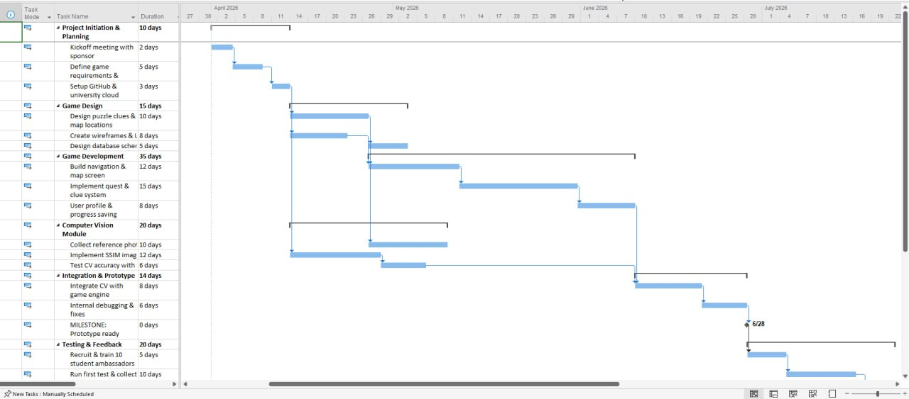
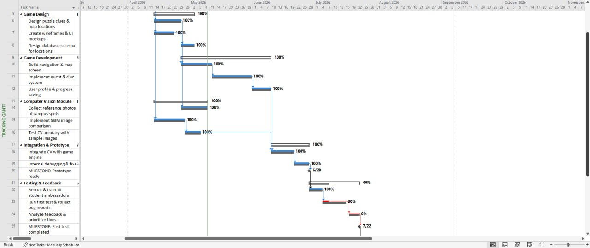
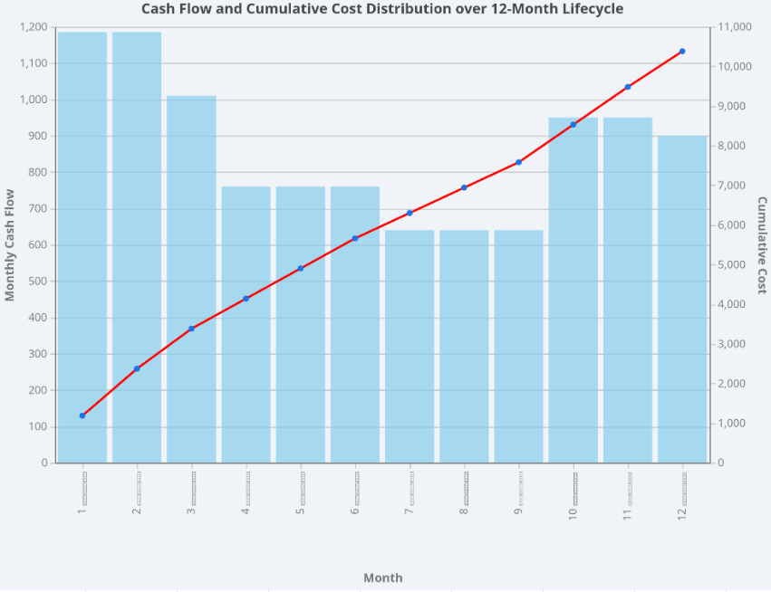

# Information Technology Project Management

Four project-management assignments completed for the **Information Technology Project Management** course at the **University of Tehran**.

The repository contains Microsoft Project schedules, cost-estimation workbooks, stakeholder reports, and planning diagrams. The assignments apply work breakdown structures, baseline tracking, precedence relationships, critical-path analysis, slack calculations, and cost planning to different IT project scenarios.

These are planning and analysis deliverables. The applications and systems described in the reports are project scenarios, rather than software implementations included in this repository.

## Assignments

| Assignment | Scenario | Main deliverables |
| --- | --- | --- |
| [CA1](CA1/) | Early identification of students at risk of dropping out | Work breakdown structure, project schedule, and planning report |
| [CA2](CA2/) | Campus Quest: a campus-exploration game with a computer-vision component | Initial schedule, tracking schedule, progress analysis, and recovery recommendations |
| [CA3](CA3/) | Daily sports training and management application | Precedence diagram, manual CPM calculations, slack analysis, and a Microsoft Project schedule |
| [CA4](CA4/) | Elder-care robot and companion application | Cost estimation, monthly cost baseline, cumulative cost curve, and stakeholder report |

## CA1: Work breakdown structure and scheduling

The first assignment plans an early-warning system for identifying students at risk of dropping out. The report breaks the work into phases and discusses the relationship between data preparation, model development, user-facing components, and deployment.

- [Microsoft Project schedule](CA1/CA1.mpp)
- [Planning report — PDF](CA1/Report.pdf)

## CA2: Baseline tracking and schedule recovery

The Campus Quest case study compares the original project plan with a tracking schedule. The report examines a testing delay and proposes recovery actions involving staffing, scope, parallel work, and deployment activities.

- [Initial schedule](CA2/main.mpp)
- [Tracking schedule](CA2/tracking.mpp)
- [Baseline Gantt chart](CA2/main.png)
- [Tracking Gantt chart](CA2/tracking.png)
- [Progress report — PDF](CA2/report.pdf)
- [Progress report — HTML](CA2/report.html)

### Schedule previews

| Initial plan | Tracking view |
| --- | --- |
|  |  |

Dates, staffing figures, and recovery estimates in the report belong to the assignment's scenario.

## CA3: Critical-path and slack analysis

This assignment models the development and launch of a sports application using finish-to-start dependencies. The materials compare manual early/late start and finish calculations with Microsoft Project results, including total slack, free slack, and the effects of calendar assumptions.

- [Assignment specification](CA3/ITPM_Exercise_3.pdf)
- [Manual analysis and stakeholder report — HTML](CA3/manual.html)
- [Submitted report — PDF](CA3/Group7_Mirzaei_Sahraei/report.pdf)
- [Microsoft Project schedule](CA3/Group7_Mirzaei_Sahraei/CA3.mpp)
- [PDM network diagram](CA3/PDM-network-diagram.jpeg)
- [Detailed Gantt chart](CA3/detail-gantt-chart.jpeg)
- [Manual calculation image](CA3/manual.jpeg)

## CA4: Cost estimation and baseline

The final assignment develops a cost plan for an elder-care robot and its companion application. It organizes labor and non-labor costs by work package, distributes planned spending over a 12-month lifecycle, and communicates the assumptions to stakeholders.

- [Project cost-estimation workbook](CA4/Project%20Cost%20Estimation%20Table.xlsx)
- [Cost-baseline workbook](CA4/Cost%20Baseline.xlsx)
- [Stakeholder report — PDF](CA4/Stakeholder%20Report.pdf)
- [Stakeholder report — HTML](CA4/elder_care_robot_english_report.html)
- [Cost-curve image](CA4/s-curve.png)



The budget figures are coursework estimates stated in **Tomans**. Check each document's unit labels: some tables use full amounts and others use millions of Tomans.

## Viewing the materials

Clone the repository:

```bash
git clone https://github.com/mhieir/ITPM.git
cd ITPM
```

| Format | How to view it |
| --- | --- |
| `.mpp` | Open with Microsoft Project or a compatible viewer. Use Microsoft Project when checking scheduling behavior and calendar settings. |
| `.xlsx` | Open with Microsoft Excel or a compatible spreadsheet application. |
| `.pdf` | Open in a PDF reader or view the GitHub preview. |
| `.html` | Download and open locally in a web browser. GitHub normally displays HTML source rather than rendering the report as a webpage. |
| `.png` / `.jpeg` | Open directly in a browser or image viewer. |

There is no application to build or package dependency to install. Start with the PDF reports for an overview, then open the editable schedules and workbooks to inspect the planning details. Written material is in English and Persian, depending on the assignment.

## Skills demonstrated

- Structuring an IT project into work packages and milestones.
- Modeling task dependencies and preparing Gantt and precedence diagrams.
- Comparing baseline schedules with progress updates.
- Calculating and interpreting critical paths and slack.
- Preparing cost estimates, phased budgets, and stakeholder reports.

## Contributors

**Mahdis Mirzaei** and **Soroush Sahraei** — Group 7, University of Tehran.

Refer to the individual reports for assignment-specific details.
